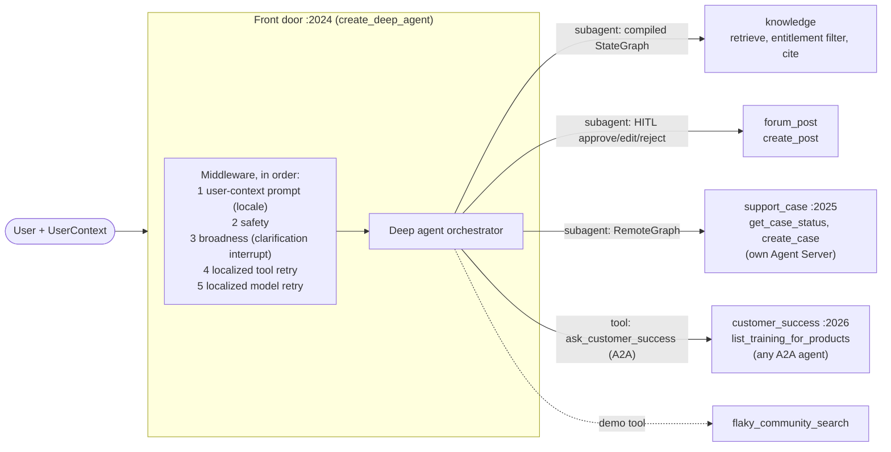

# Community Assistant: multi-agent reference

A runnable reference for a community assistant built as a **top-level orchestrator
(a Deep Agents front door)** that composes specialists in three different ways:
a compiled subgraph, a `RemoteGraph` to another team's server, and an A2A call to
an agent that could run on any stack. It is modeled on a community assistant that
answers product questions, helps users post to a forum, and hands off to support.

Everything external is mocked (knowledge base, forum, support cases, training
catalog) and filled with mock content. The point is the architecture and the
plumbing, which you can lift into your own code.

## Architecture



| Piece | Where | How the front door reaches it |
|---|---|---|
| Front door | `src/community_assistant/front_door/agent.py` | the entry point (`langgraph.front_door.json`, port 2024) |
| `knowledge` | `front_door/knowledge.py` | compiled LangGraph `StateGraph` passed as a `CompiledSubAgent` (in process) |
| `forum_post` | `front_door/forum.py` | subagent with `interrupt_on` for `create_post` (approve / edit / reject) |
| `support_case` | `support_case/agent.py` | `RemoteGraph` over the network (`langgraph.support_case.json`, port 2025) |
| `ask_customer_success` | `front_door/remote_agents.py` | A2A JSON-RPC `message/send` tool (`langgraph.customer_success.json`, port 2026) |
| `flaky_community_search` | `front_door/demo_tools.py` | plain tool with scripted failures, to show retry behaviour |

The same `UserContext` (user id, roles, entitlements, purchased products, locale)
is passed at invocation and travels across every boundary. Each agent enforces its
own rules on it: the knowledge graph filters articles by entitlement, Support Case
hides `create_case` from users without the `can_create_case` role, and Customer
Success looks up training for that user's purchased products.

## Mapping from a flat graph

If your assistant is one flat graph of guard nodes plus an orchestrator loop, this
is where each piece goes.

| Flat graph | Here |
|---|---|
| `safety_check` node | `SafetyMiddleware`: input check before the agent runs, output check on the final answer |
| `broadness_check` + follow-up node | `BroadnessMiddleware`: calls `interrupt()` with a clarifying question; the reply resumes the same run |
| orchestrator + tools loop | the deep agent (`create_deep_agent`) with subagents and tools |
| retry once, then error node | `LocalizedToolRetryMiddleware` (tools) and `LocalizedModelRetryMiddleware` (model calls), each retrying once; a final failure becomes the localized failure message, never the raw error |
| RAG pipeline | a compiled `StateGraph` (retrieve, filter by entitlement, answer with citations) used as the `knowledge` subagent |
| tools owned by other teams | `RemoteGraph` or A2A, see the decision guide below |

The middleware order matters: the user-context prompt is first, then safety, then
broadness (so a clarification reply is checked for safety too), then the retries.
The code is in `front_door/middleware.py`; `front_door_middleware()` returns the list.

Only tools that are safe to call twice are retried (`RETRIED_TOOLS`:
`flaky_community_search` and `ask_customer_success`). A `task` delegation is not
retried, because a retry re-runs the whole subagent, including side effects such as
an approval or a created case. Every tool's final error still becomes the localized
failure message.

## Decision guide: subgraph vs RemoteGraph vs A2A

| | Compiled subagent (subgraph) | `RemoteGraph` | A2A |
|---|---|---|---|
| Who owns it | your team | another team | another team or vendor |
| Deployed | with the front door | independently (own Agent Server) | independently, any stack |
| Requires LangGraph on the other side | yes, in process | yes | no |
| State, streaming, interrupts | in-process, lowest latency; exchanges messages with the parent | LangGraph threads and interrupts; behind a deep agent's task tool the approval flow needs the wrapper below | whatever the A2A contract exposes (message in, reply out) |
| Contract | a Python graph | the graph's input/output schema | the agent card and A2A message format |
| Pick it when | you already have the graph and own the deploy | the other team runs LangGraph and you want to keep threads, approvals and streaming | the other side is not (or may not stay) on LangGraph, or you want the loosest coupling |
| Cost | none | a network hop, plus the plumbing in the lessons below | lowest common denominator: no shared state; this demo's A2A call is message in, reply out, with no approval round-trip |

Rule of thumb: start with a subgraph for what you own, use `RemoteGraph` when
another team's LangGraph agent must keep its approvals and threads, and use A2A
at the edge where you can't assume LangGraph.

## Lessons from wiring this up

Four things were not obvious. They are the most reusable parts of this repo.

1. **Runtime context is not forwarded to a `RemoteGraph`; forward it explicitly.**
   A deep agent's `task` tool calls the subagent without the parent's runtime
   context, so a remote run sees no user. `ContextForwardingRemoteGraph`
   (`front_door/remote_agents.py`) passes the user context itself, and the remote
   server enforces its own rules on it. The Agent Server also rejects a request
   that sets both `configurable` and `context`, so the class moves the task tool's
   `configurable` keys into metadata.
2. **Give each delegation its own deterministic remote thread to round-trip an
   approval.** The `task` tool runs subagents statelessly (no `thread_id`), so a
   remote interrupt (Support Case's `create_case` approval) comes back as data and
   cannot be resumed. The wrapper derives a thread per delegation
   (`uuid5` of the parent thread and the task's `checkpoint_ns`) and re-raises the
   remote interrupt in the front door with `interrupt()`. On resume it sends the
   user's decision as `Command(resume=...)` to that same remote thread. Separate
   delegations, including parallel ones, never share history.
3. **The Agent Server's A2A endpoint is addressed by assistant UUID, not graph id.**
   `/a2a/customer_success` is rejected ("Invalid assistant ID: must be a UUID").
   Set `CUSTOMER_SUCCESS_A2A_URL` to the full A2A endpoint of the agent, as its
   owner documents it. If unset, a local-dev fallback computes the default
   assistant's UUID from the graph id. `fetch_agent_card()` (the notebook shows it)
   reads the agent card from `CUSTOMER_SUCCESS_AGENT_CARD_URL` if set, else from the
   Agent Server's per-assistant path `<endpoint>/.well-known/agent-card.json`.
   The user context is sent twice: in `message.metadata["user_context"]`, the
   standard A2A place any agent can read, and in `params.context`, an Agent Server
   extension to A2A that the server maps to the remote run's `runtime.context`.
   A transport or JSON-RPC failure raises `A2AError`, so the tool-retry middleware
   retries the call once and then returns the localized failure message.
4. **Distributed tracing needs the receiving side to parent the run.** The caller
   sends the `langsmith-trace` header (`RemoteGraph(distributed_tracing=True)`, and
   explicit headers on the A2A call). In the Agent Server version pinned here, the
   header reaches the run's config but nothing turns it into a parent, so remote
   runs showed up as separate traces. The remote servers serve
   `community_assistant/tracing.py:make_graph`, which continues the caller's trace
   from that header. A malformed header is ignored and the run is traced on its own.
   The A2A call sends these headers to whatever endpoint is configured. The trace id
   is not a secret, but `baggage` names your LangSmith project: drop the headers in
   `_tracing_headers()` if the A2A agent belongs to a third party.

Also worth copying: **role-based tool access** in `support_case/agent.py`. A
middleware removes `create_case` from the model's tools for users without
`can_create_case`, so they get a plain refusal instead of an approval prompt that
would then be denied. The tool body re-checks the role as defence in depth.

## Context propagation and real auth

Here the user's identity is **passed, not authenticated**: the caller supplies a
`UserContext` (the notebook and smoke test pick one of three demo users in
`context.py`) and each service trusts it. That keeps the demo about architecture.
For production, authenticate with **Agent Server custom auth** on each deployment,
derive the user context from the verified token on the server side, and have the
front door forward the user's credential to the remote servers rather than a
self-asserted context. Missing or malformed context fails closed in the agents that
need it.

Send the context on **every** run, including the one that resumes an interrupt
(an approval or a clarification reply): runtime context is per run and is not
stored on the thread. `scripts/demo_helpers.py` does this for both `run_turn` and
`resume`. In LangGraph Studio, the graphs declare `UserContext` as their context
schema, so Studio shows a context editor for the run. Set it to one of the
`DEMO_USERS` entries from `context.py` in its JSON form (`UserContext.to_dict()`)
and leave it set while you answer interrupts, for example:

```json
{"user_id": "u-1001", "display_name": "Alex Morgan", "roles": ["customer", "can_create_case"],
 "entitlements": ["HCM", "Payroll"], "purchased_products": ["Acme HCM", "Acme Payroll"],
 "locale": "en_US"}
```

## Setup and run

Requires Python 3.11+ and [`uv`](https://docs.astral.sh/uv/).

```bash
uv sync
cp .env.example .env     # then fill in keys, see below
make dev-all             # front door :2024, Support Case :2025, Customer Success :2026
```

`.env` settings:

| Variable | Purpose |
|---|---|
| `ANTHROPIC_API_KEY` / `GOOGLE_API_KEY` | key for whichever provider you use |
| `COMMUNITY_MODEL` | an `init_chat_model` string. Default `anthropic:claude-sonnet-5-5`; `google_genai:gemini-2.5-pro` also works |
| `COMMUNITY_MODEL_BASE_URL` | optional. Routes model calls through an LLM gateway or proxy; unset uses the provider default |
| `LANGSMITH_API_KEY`, `LANGSMITH_TRACING`, `LANGSMITH_PROJECT` | tracing (and the API key used for remote calls on LangSmith Deployment). `.env.example` ships with `LANGSMITH_TRACING=false`; set it to `true` with a key to see the traces |
| `SUPPORT_CASE_URL` | Support Case server (default `http://127.0.0.1:2025`) |
| `CUSTOMER_SUCCESS_URL` | Customer Success server (default `http://127.0.0.1:2026`) |
| `CUSTOMER_SUCCESS_A2A_URL` | full A2A endpoint of the Customer Success agent; unset uses the local-dev computed path |
| `CUSTOMER_SUCCESS_AGENT_CARD_URL` | optional; where to fetch the agent card. Unset uses `<A2A endpoint>/.well-known/agent-card.json` (the Agent Server's per-assistant card) |
| `CUSTOMER_SUCCESS_API_KEY` | optional; sent as `x-api-key` on the A2A call and agent-card fetch. Never defaults to `LANGSMITH_API_KEY` |

Minimum: `ANTHROPIC_API_KEY` (or the key for your `COMMUNITY_MODEL` provider) in `.env` before `make dev-all`. If model calls go through a gateway, also set `COMMUNITY_MODEL_BASE_URL`.

Each server can also be started on its own: `make dev-front-door`,
`make dev-support-case`, `make dev-customer-success`. Open a server in LangGraph
Studio at `https://smith.langchain.com/studio/?baseUrl=http://127.0.0.1:2024`
(change the port for the others).

### Commands

| Command | What it does |
|---|---|
| `make test` | unit tests only; no real model and no servers |
| `make smoke` | runs the 8 scenarios below against the live servers from `make dev-all`, with the real model; prints PASS/FAIL per scenario |
| `make notebook` | re-executes `demo.ipynb` top to bottom against the live servers and saves the outputs in place |

## The 8 scenarios

`demo.ipynb` walks through them, one cell each, with the expected behaviour
explained. The notebook runs scenario 3 last, so the walkthrough ends on the safety
guardrail; the scenarios are independent, so the order doesn't matter. `scripts/smoke_test.py` runs them as checks. Each run is tagged with
`metadata.scenario` so you can find its trace in LangSmith.

| # | Scenario | Shows |
|---|---|---|
| 1 | Knowledge question | compiled subgraph, entitlement filter, cited answer |
| 2 | Broad question ("Tell me about payroll") | clarification interrupt from middleware, resume |
| 3 | Unsafe input | safety middleware refusal, no specialist called |
| 4 | Forum post | human-in-the-loop approval before `create_post` |
| 5 | Support case | `RemoteGraph`, remote approval surfaced to the front door; then the same request without the role |
| 6 | Training for owned products | A2A call with user context |
| 7 | Case status + docs + training in one question | three specialists, one connected trace |
| 8 | Self-healing | `[flaky]` recovers on retry; `[down]` gives a localized failure message |

## Deploying to LangSmith Deployment

Deploy each `langgraph.*.json` as its own deployment: `langgraph.front_door.json`,
`langgraph.support_case.json`, `langgraph.customer_success.json`. Then, on the
front door deployment, set:

- `SUPPORT_CASE_URL` to the Support Case deployment URL
- `CUSTOMER_SUCCESS_URL` to the Customer Success deployment URL, and
  `CUSTOMER_SUCCESS_A2A_URL` to its full A2A endpoint (the computed fallback is
  for local dev)
- `LANGSMITH_API_KEY`, which the `RemoteGraph` call sends as `api_key` to the Support Case deployment
- `CUSTOMER_SUCCESS_API_KEY`, a key for the workspace that hosts the Customer Success deployment, sent as `x-api-key` on the A2A call. It is a separate variable on purpose: the A2A endpoint may belong to a third party, so `LANGSMITH_API_KEY` is never sent to it automatically.
- the model variables above (including `COMMUNITY_MODEL_BASE_URL` if you use a gateway)

A connected trace needs all three deployments tracing to the same LangSmith workspace (`LANGSMITH_TRACING=true` and a workspace `LANGSMITH_API_KEY` on each). The caller's project travels in the `baggage` header, so remote runs land under the front door's project. `LANGSMITH_PROJECT` doesn't need to match on the remotes. The connected trace is verified locally on `langgraph dev`; verify it once on your deployment.

Replace the demo `UserContext` handling with custom auth before exposing anything to real users.

## Not covered

Async subagents, evals, MCP, summarization, and starter-tile shortcuts are out of
scope for this reference.
