# Community Assistant: multi-agent reference

A Deep Agents orchestrator that calls other agents in three ways: as a compiled
subgraph, through `RemoteGraph` to another server, and over A2A. Deterministic checks
(safety, clarification, tool retry) are middleware. All external systems are mocked.

## Architecture



Source: `docs/img/architecture.mmd`.

A `UserContext` (roles, entitlements, locale) is passed with every run and
forwarded across every boundary. Each agent enforces its own rules on it.

## Which way to call another agent

| | Subgraph | `RemoteGraph` | A2A |
|---|---|---|---|
| Owner | your team | another team | another team or vendor |
| Other side must run LangGraph | yes, in process | yes | no |
| Keeps threads and interrupts | yes | yes | no, message in and reply out |
| Use when | you own the graph and the deploy | the other team runs LangGraph | you can't assume LangGraph |

## Things worth knowing

- **Context isn't forwarded to a `RemoteGraph` automatically.** `ContextForwardingRemoteGraph`
  in `front_door/remote_agents.py` forwards it, and gives each delegation its own remote
  thread so remote approvals can be resumed.
- **The Agent Server's A2A endpoint takes an assistant UUID, not a graph id.** Set
  `CUSTOMER_SUCCESS_A2A_URL` to the full endpoint.
- **To join remote runs into the caller's trace,** the remote servers use `tracing.py:make_graph`.
- **Only tools that are safe to repeat are retried.** Subagent delegations aren't retried.
- **Identity is passed, not authenticated.** Use Agent Server custom auth in production.

## Run it

Requires Python 3.11+ and [`uv`](https://docs.astral.sh/uv/).

```bash
uv sync
cp .env.example .env     # add your model provider key
make dev-all             # front door :2024, Support Case :2025, Customer Success :2026
```

To use a different model, set `COMMUNITY_MODEL` to an `init_chat_model` string. Set
`COMMUNITY_MODEL_BASE_URL` to route model calls through a gateway. `.env.example`
lists the rest.

| Command | What it does |
|---|---|
| `make test` | unit tests (no model or servers) |
| `make smoke` | runs the scenarios against the live servers |
| `make notebook` | re-runs `demo.ipynb` |

## Scenarios

`demo.ipynb` walks through these:

1. Knowledge question: subgraph with an entitlement filter
2. Broad question: clarification interrupt from middleware
3. Unsafe input: refused by the safety middleware
4. Forum post: approved before posting
5. Support case: remote approval through `RemoteGraph`, and a refusal for a user without the role
6. Training for owned products: over A2A
7. One question that uses three agents: one connected trace
8. Self-healing: a tool recovers on retry, and a hard failure gives a localized message

## Deploying

Deploy each `langgraph.*.json` as its own LangSmith Deployment. On the front door,
set `SUPPORT_CASE_URL`, `CUSTOMER_SUCCESS_URL`, `CUSTOMER_SUCCESS_A2A_URL`,
`LANGSMITH_API_KEY` and `CUSTOMER_SUCCESS_API_KEY`.
